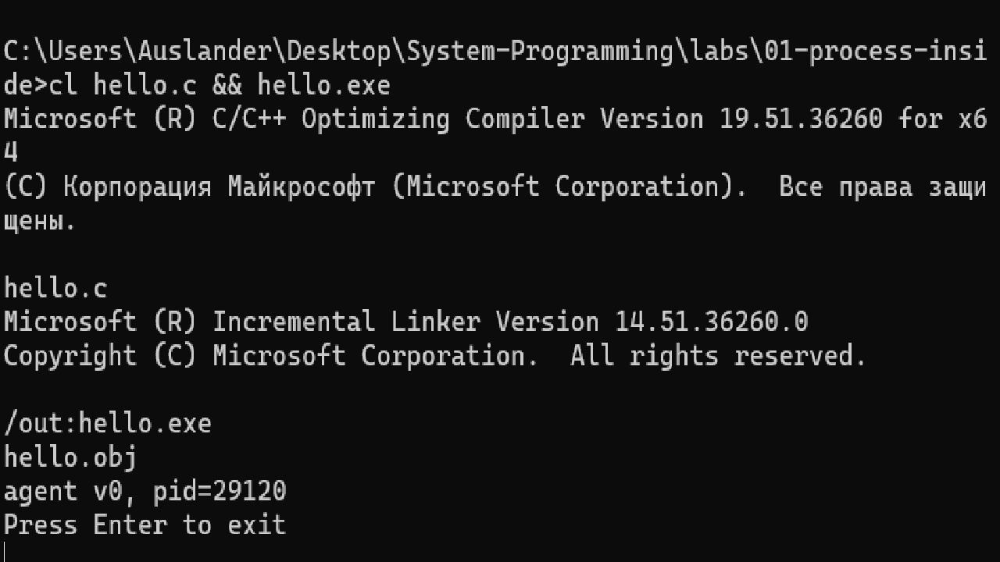
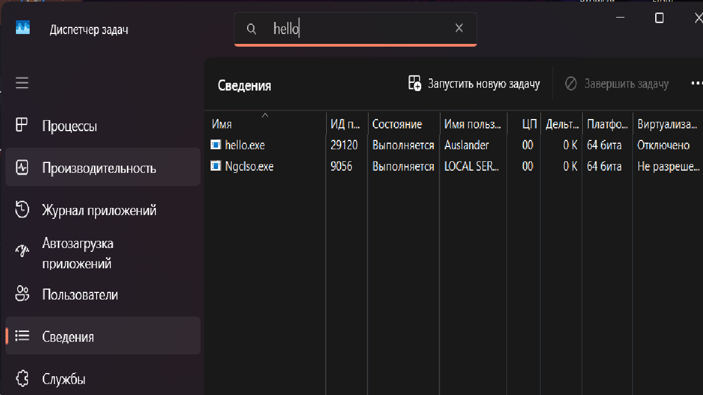
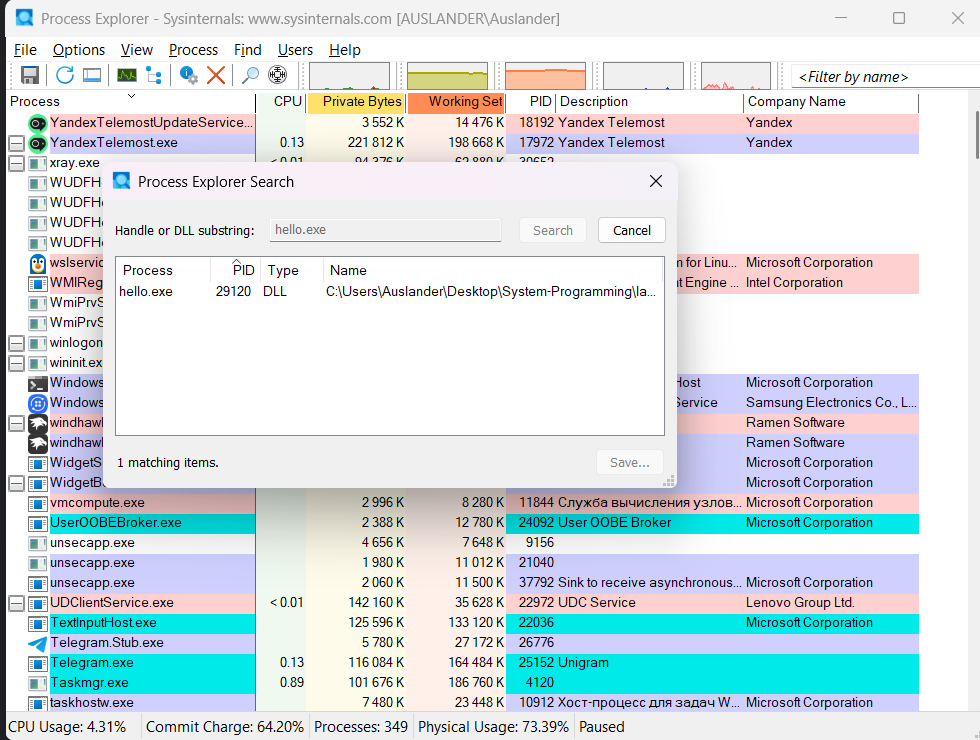
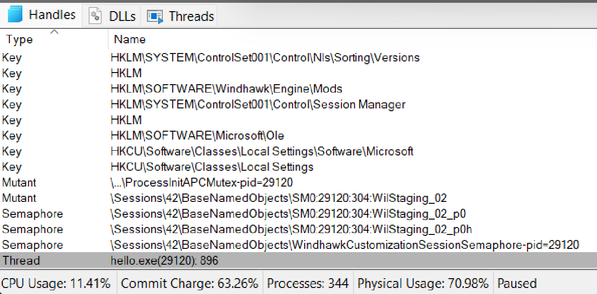
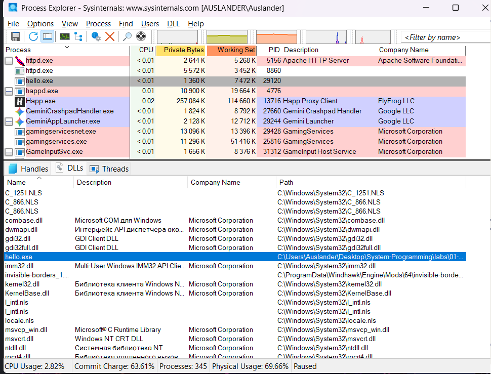
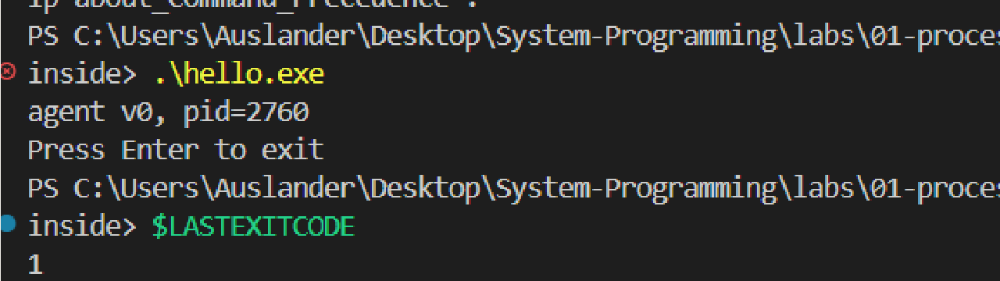
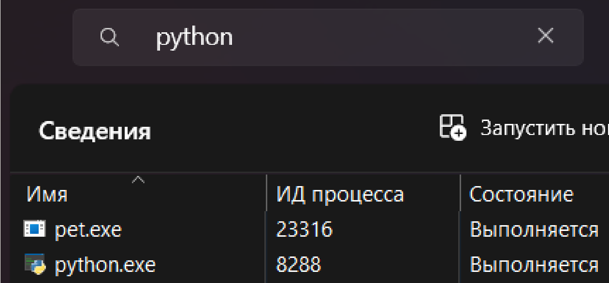
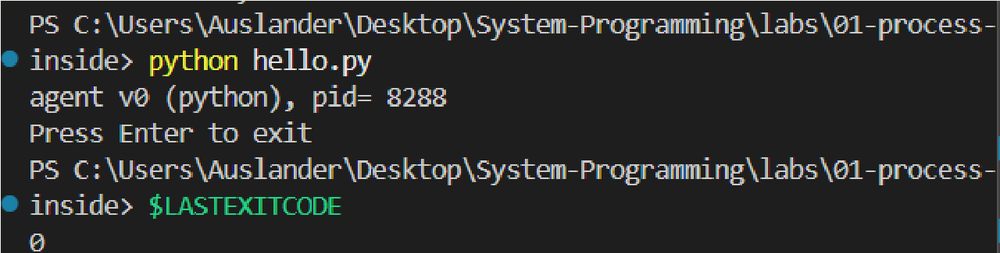

# ЛР 1. Процесс изнутри

Система: Windows 11 · компилятор: Microsoft (R) C/C++ Optimizing Compiler Version 19.51.36260 for x64

## Программа на C
Программа напечатала PID 29120, монитор показал PID 29120.
Память процесса в мониторе: ___ КБ *(посмотрите значение в столбце «Память» на скрине 02)*. Процессорное время: ___ *(посмотрите Kernel Time / User Time на скрине 03)*.
Пока программа ждёт Enter, процессорное время не растёт, потому что процесс заблокирован в системном вызове ожидания ввода (getchar) и переведён планировщиком ОС в состояние ожидания (Waiting), не занимая процессорное время.
Дескрипторов у процесса: ___ *(посмотрите значение Handles на скрине 03)*. Ввод и вывод ведут в устройство консоли Windows (`\Device\ConDrv`).
Системные библиотеки в процессе: `ntdll.dll`, `kernel32.dll`, `KernelBase.dll`.
После завершения из монитора терминал напечатал ничего (вернул строку приглашения), код завершения 1.

## Программа на Python
Имя процесса в мониторе: `python.exe`, PID 8288, память ___ КБ *(посмотрите значение в столбце «Память» на скрине 07)*.
Памяти больше, чем у программы на C, примерно в ___ раз *(разделите память python.exe на память hello.exe и округлите до целого)*.
Общая библиотека у программ на C и Python: `kernel32.dll`, `KernelBase.dll`, `ntdll.dll`.
Код завершения при обычном выходе: 0.

Не получилось: всё получилось, проблем при выполнении не возникло.

## Снимки экрана

Сохраните снимок поверх заглушки в папке `screenshots/` с тем же именем — ссылки ниже менять не нужно.

### 1. Программа на C запущена
Шаг 1. Видно: команда сборки и строка `agent v0, pid=…` в терминале.

### 2. Свой процесс в мониторе
Шаг 3. Видно: строка процесса `hello` с тем же номером, что напечатала программа.

### 3. Свойства процесса
Шаг 4. Видно: окно процесса `hello`: номер, память, процессорное время.

### 4. Дескрипторы процесса
Шаг 5. Видно: открытые файлы или дескрипторы: папка программы и устройство терминала.

### 5. Библиотеки процесса
Шаг 6. Видно: загруженные библиотеки (в Linux — карта памяти).

### 6. Процесс завершён из монитора
Шаг 8. Видно: терминал после завершения: сообщение оболочки и код завершения.

### 7. Программа на Python в мониторе
Шаг 9. Видно: строка `agent v0 (python), pid=…` и процесс Python с тем же номером.

### 8. Обычный выход
Шаг 11. Видно: терминал после Enter: код завершения 0.

