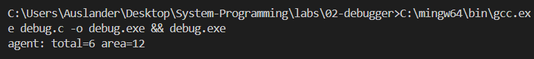
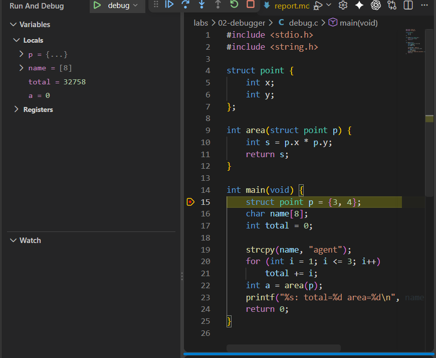
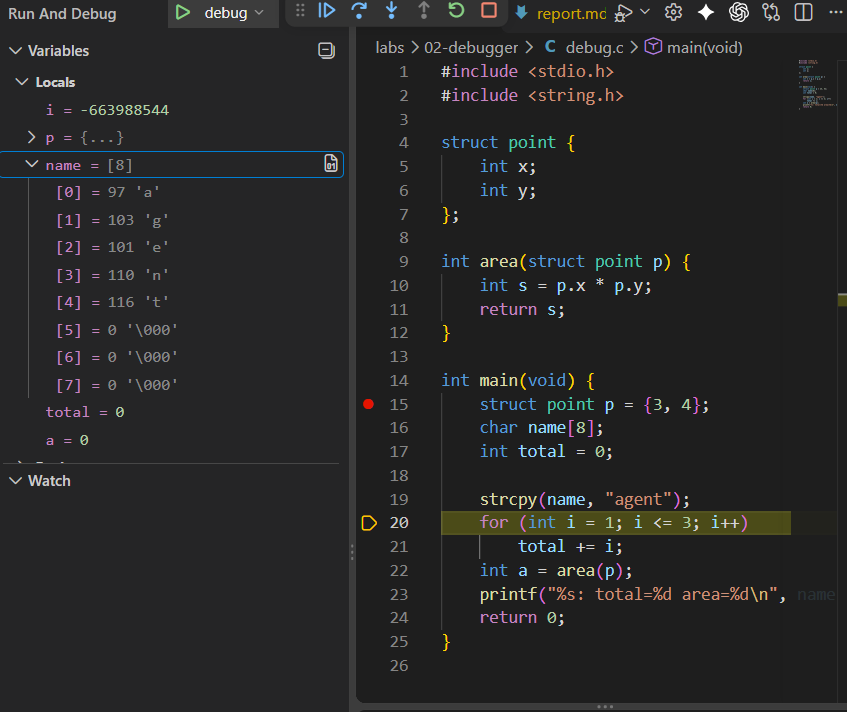
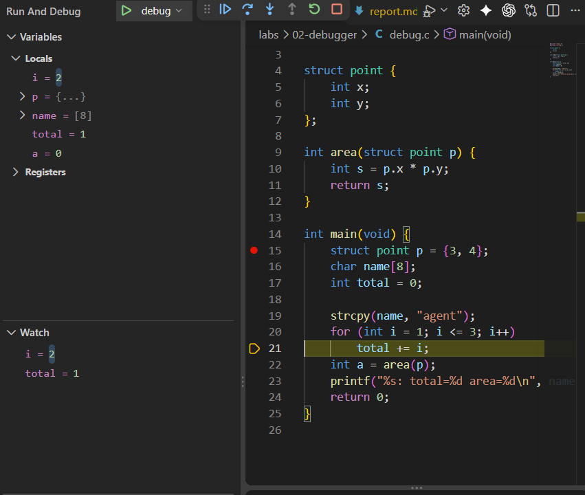
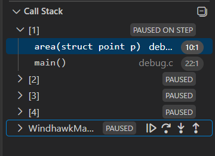
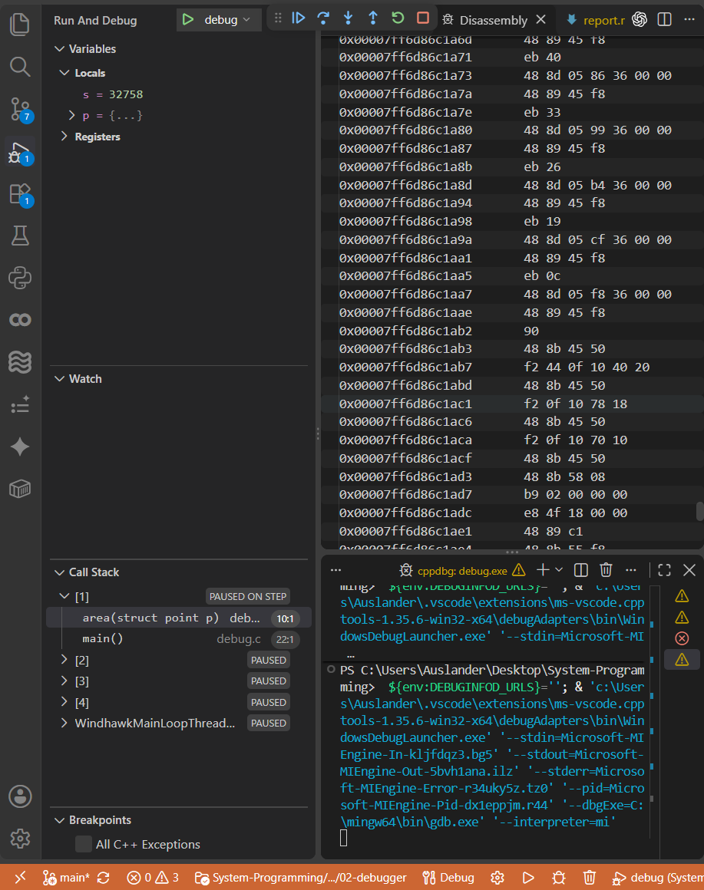

# ЛР 2. Программа в отладчике

Система: Windows · отладчик: GCC / GDB (в конфигурации VS Code)

## Остановка и переменные
Программа без отладчика напечатала: `agent: total=6 area=12`

Точка останова на строке 15.

До строки 15: p.x = 0, p.y = 0, total = 0 (в ячейках памяти находились нули или остаточные мусорные значения).
После строки 15: p.x = 3, p.y = 4.
Строку 16 отладчик пропустил, потому что `char name[8];` только объявляет массив, для неё нет отдельных машинных команд.
name[0] = 97 (код буквы 'a'), завершающий ноль в ячейке name[5].

## Цикл и функция
На кадре цикла: i = 2, total = 1; после следующего шага total = 3.

В стеке внутри area строк: 2, сверху функция area.

Команда умножения в машинном коде: imul.

Перед printf: a = 12, total = 6.
Код завершения программы: 0.

## Помощник ИИ (Р1)
Запрос: «Почему до выполнения строки 15 в p.x лежит случайное число?». 
Совпал ли ответ с шагом 4: Да, ответ ИИ полностью совпал. ИИ пояснил, что память под локальные переменные функции выделяется на стеке в момент входа в неё, а фактическое присвоение значений происходит только при выполнении строки 15. До этого момента в выделенной памяти лежат старые "мусорные" байты.

Не получилось: Изначально запустить встроенный компилятор MSVC (`cl`) из обычного терминала PowerShell из-за синтаксиса `&&` и отсутствия настроенных путей окружения в Windows.
ИИ: использовал для установки проклятого компилятора языка C (MinGW-w64/GCC), добавления его в переменные среды, перенастройки конфигурационных файлов `launch.json` и `tasks.json` под GCC, а также для поиска команд открытия Disassembly View.
