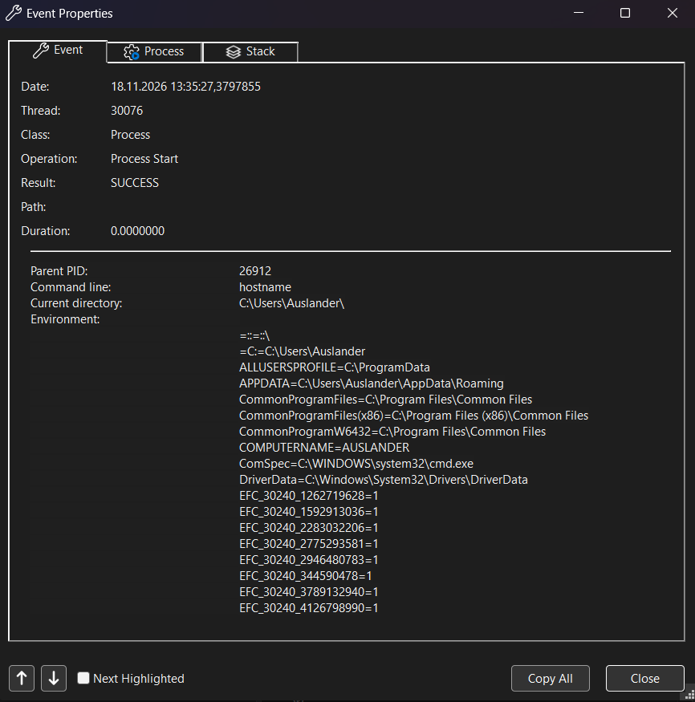
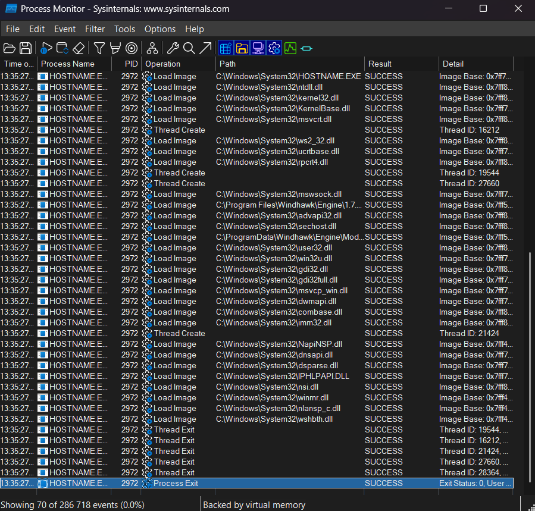
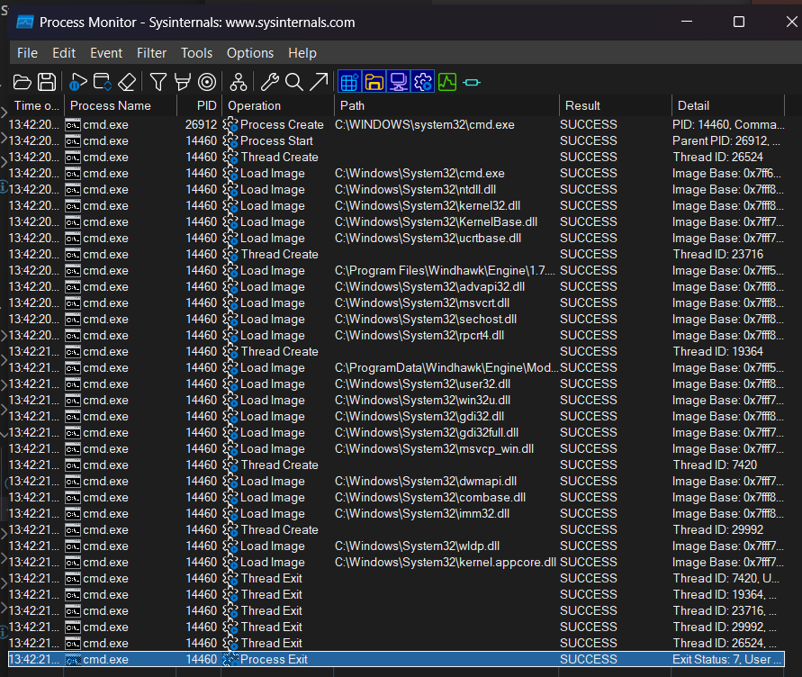
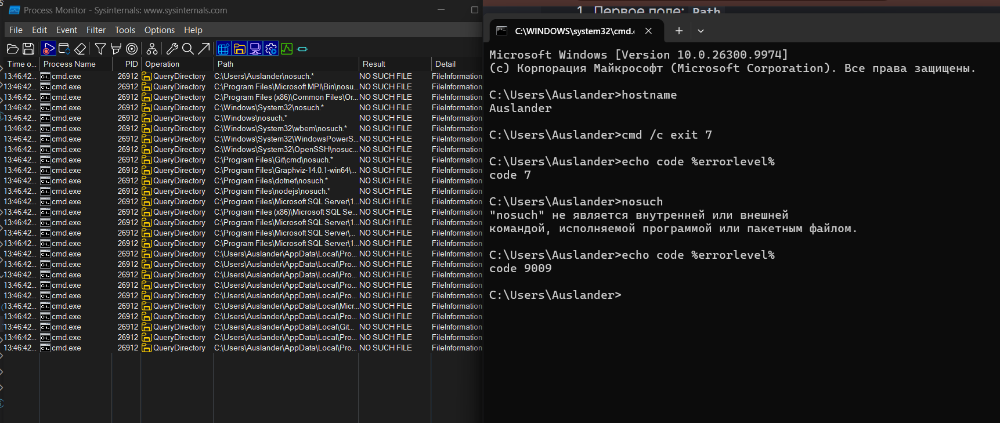
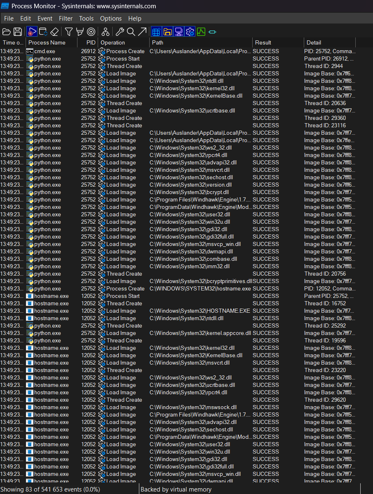

# ЛР 5. Рождение процесса

Система: Windows
Программа записи: Process Monitor (Procmon64.exe)

## Рождение
Родитель (имя и номер): cmd.exe (PID 26912)
Номер нового процесса: 2972 (HOSTNAME.EXE)
Событие или вызов, которым создан процесс: событие Process Create (системный вызов CreateProcessW)
Библиотек загружено и первая из них: 29 библиотек (.dll), первая — ntdll.dll

## Завершение
Код завершения у ребёнка и у родителя: 7 (Exit Status: 7 у ребёнка в Process Exit и %errorlevel% = 7 у родителя)
Программа nosuch: папок проверено 26, ошибка NO SUCH FILE (ошибка 2, ERROR_FILE_NOT_FOUND), код 9009

## Запуск из Python
Номер Python и номер ребёнка: 25752 (python.exe) и 12052 (hostname.exe)
Чем запуск из Python отличается от запуска из оболочки: принципиально ничем не отличается — функция subprocess.run так же подаёт ядру системный вызов CreateProcessW (событие Process Create) и ожидает завершения дочернего процесса.

Не получилось: в самом начале по ошибке был запущен Process Explorer вместо Process Monitor, а клавиша End на цифровой клавиатуре (Numpad) не прокручивала список без отключения NumLock.

## Снимки экрана

Сохраните снимок поверх заглушки в папке `screenshots/` с тем же именем — ссылки ниже менять не нужно.

### 1. Рождение процесса
Шаг 1. Видно: запись запуска `hostname`: родитель создаёт процесс, у нового процесса номер родителя.

### 2. Библиотеки нового процесса
Шаг 2. Видно: библиотеки, которые загрузил `hostname`, и первая из них.

### 3. Код завершения 7
Шаг 3. Видно: завершение ребёнка с кодом 7 и тот же код у родителя.

### 4. Программы нет
Шаг 4. Видно: поиск `nosuch` по папкам из PATH и ошибка «не найдено».

### 5. Запуск из Python
Шаг 5. Видно: Python создаёт процесс `hostname`: номер Python и номер ребёнка.

