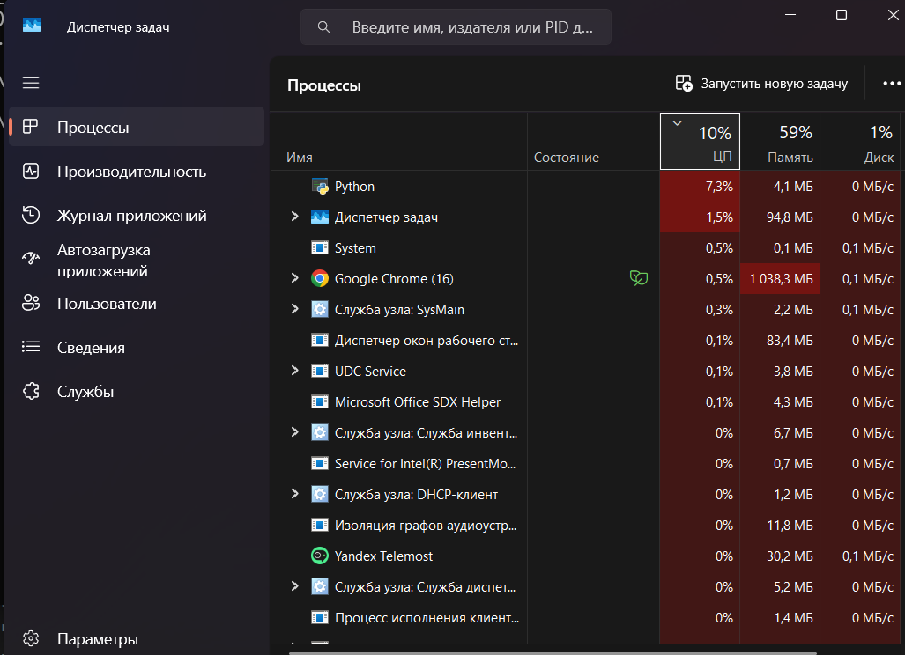
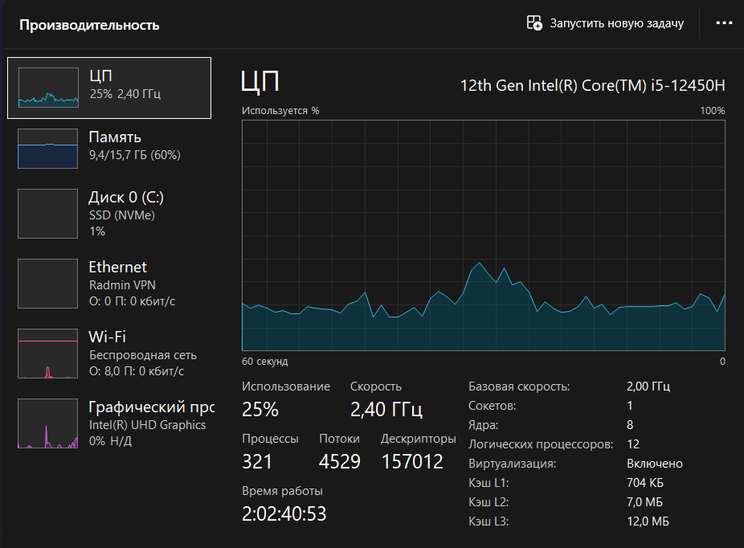
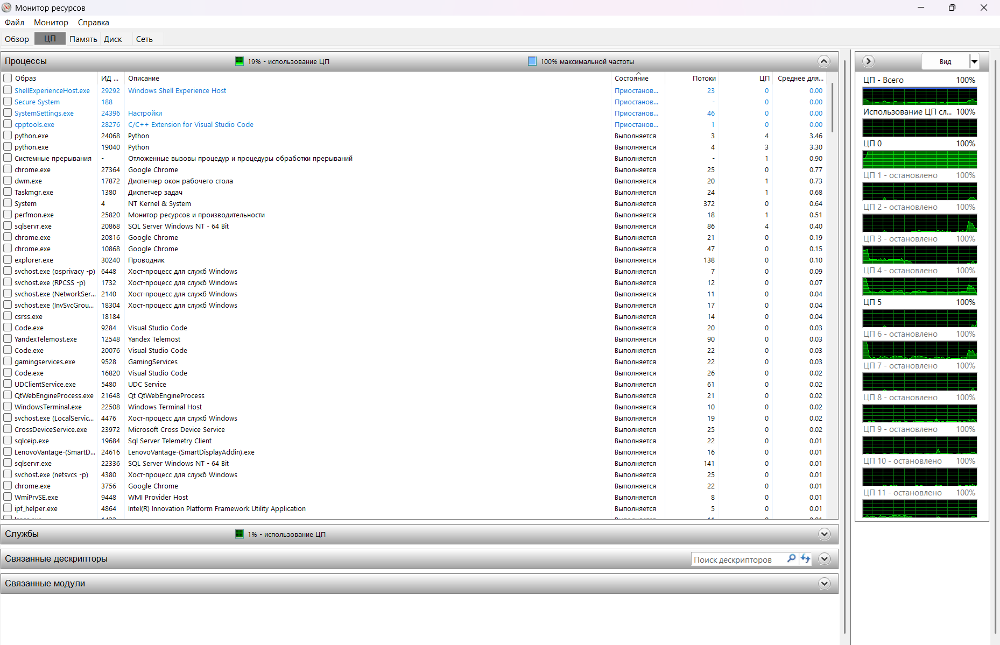
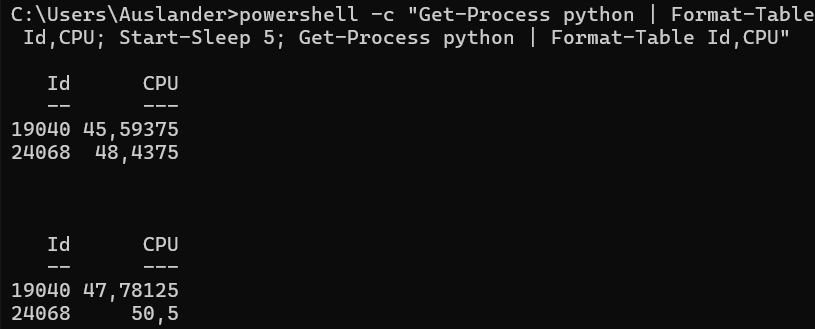

# ЛР 6. Кто загружает процессор

Система: Windows (12th Gen Intel Core i5-12450H)
Ядер (логических процессоров): 12

## Одна нагрузка
Процент процесса в мониторе: 7,3% (колеблется около 7,7–8,2%, что соответствует 1/12 части всех логических процессоров)
Общая загрузка: 10%
На каких ядрах видна нагрузка: нагрузка распределена по нескольким активным ядрам (ЦП 0, ЦП 1, ЦП 2, ЦП 4, ЦП 5, ЦП 6), программа не сидит на одном месте — планировщик Windows постоянно пересаживает её с ядра на ядро.

## Две нагрузки
Проценты обеих нагрузок и общая загрузка: каждый процесс занимает по ~7,5–8% шкалы, общая загрузка выросла до 17–28% (24% на снимке)
На одном ядре (в macOS — фоновый режим): при привязке к ядру 0 (`/affinity 1`) график ЦП 0 заполняется на 100%, а оба процесса делят его пополам — по 3,30% и 3,40% в среднем (остальные ядра этим программам недоступны).

## Процессорное время
Первый замер, второй замер, пауза: процесс 19040 — 45,59375 с → 47,78125 с; процесс 24068 — 48,4375 с → 50,5 с; пауза — 5 секунд
Загрузка по замерам: прирост 2,1875 с (43,75% одного ядра / 3,65% всей системы) и 2,0625 с (41,25% одного ядра / 3,44% всей системы)
Почему процент в мониторе не говорит о скорости работы: процент показывает лишь долю времени, когда ядро было занято задачей, но не учитывает тактовую частоту и архитектуру ядра (например, быстрые производительные P-ядра и медленные энергоэффективные E-ядра выполняют разный объём работы за одно и то же время).

Не получилось: всё выполнено успешно без сбоев.

## Снимки экрана

Сохраните снимок поверх заглушки в папке `screenshots/` с тем же именем — ссылки ниже менять не нужно.

### 1. Одна нагрузка
Шаг 1. Видно: процесс Python в мониторе: его процент и общая загрузка.

### 2. Две нагрузки
Шаг 3. Видно: два процесса Python и загрузка ядер.

### 3. Нагрузки на одном ядре
Шаг 4. Видно: две нагрузки на одном ядре и их проценты; в macOS — два числа оборотов цикла.

### 4. Процессорное время
Шаг 5. Видно: два замера процессорного времени с паузой между ними.

