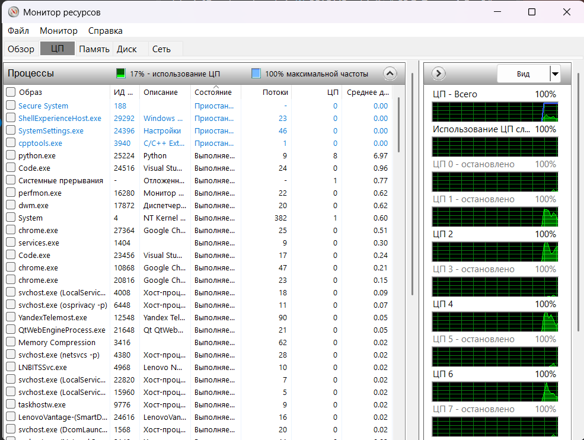
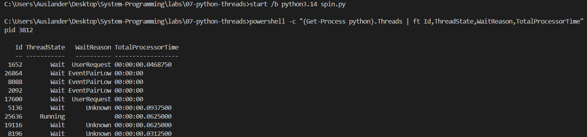
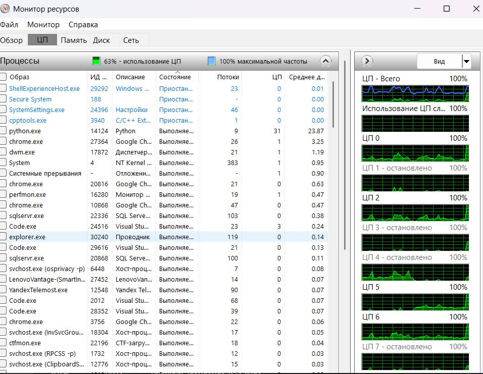
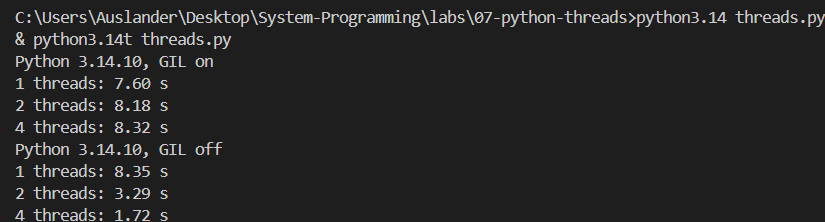

# ЛР 7. Потоки Python и GIL

Система: Windows (12th Gen Intel Core i5-12450H)
Ядер (логических процессоров): 12
Версии Python (обычный и без GIL): Python 3.14.10 и Python 3.14.10 experimental free-threading build (`python3.14t`)

## Python с GIL
Процент процесса и число потоков: 8% (среднее 6.97% — ровно 1 ядро из 12), всего 9 потоков (4 рабочих с циклом + главный и служебные)
Сколько потоков выполняется одновременно: 1 поток (в таблице потоков статус `Running` горит только у одного рабочего потока, а остальные 3 находятся в состоянии `Wait`)

## Python без GIL
Процент процесса и проценты потоков: 31% (среднее 23.87% — 4 ядра из 12 заняты одновременно), каждый из 4 рабочих потоков забирает по одному целому ядру (~8% всей шкалы системы или 100% на графике своего логического процессора)

## Время работы
С GIL, 1 / 2 / 4 потока: 7.60 с / 8.18 с / 8.32 с (ускорения нет)
Без GIL, 1 / 2 / 4 потока: 8.35 с / 3.29 с / 1.72 с (4 потока быстрее одного в 4,85 раза)
Без GIL с PYTHON_GIL=1: 5.72 с / 5.80 с / 5.44 с (ускорение пропадает при ручном включении замка)
Ожидание, 1 и 4 потока: 2.00 с и 2.00 с
Почему ожидающие потоки ускоряются и с GIL: когда поток начинает спать или ждать ответа от сети/диска, он добровольно отдаёт замок GIL, поэтому другие потоки могут забрать его и тоже уйти в ожидание одновременно.

Не получилось: при установке `uv` через PowerShell сначала оборвалась ссылка скрипта, затем пришлось вручную добавить папку `C:\Users\Auslander\.local\bin` в `PATH` и переключиться из PowerShell в обычную командную строку (`cmd`) для работы команды `start /b`.

## Снимки экрана

Сохраните снимок поверх заглушки в папке `screenshots/` с тем же именем — ссылки ниже менять не нужно.

### 1. Четыре потока с GIL
Шаг 1. Видно: процесс Python в мониторе: его процент и число потоков.

### 2. Потоки процесса
Шаг 2. Видно: список потоков процесса: сколько выполняется, сколько ждёт.

### 3. Четыре потока без GIL
Шаг 3. Видно: процесс python3.14t в мониторе: его процент.

### 4. Время работы
Шаг 4. Видно: вывод threads.py в Python с GIL и без.

